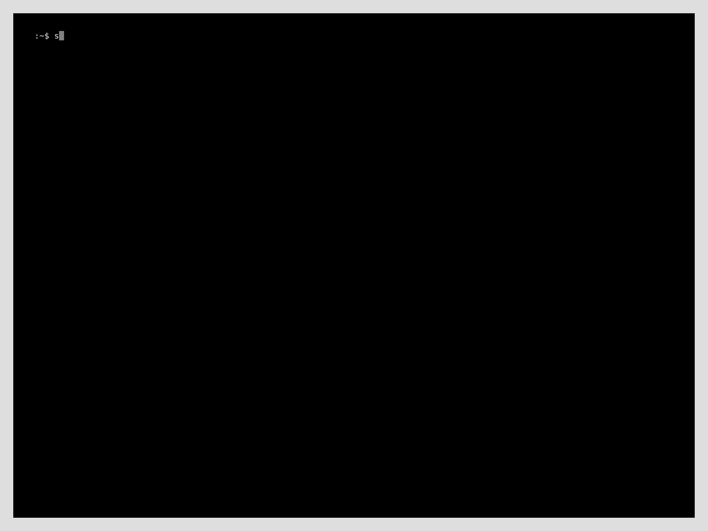

Sara is a RouterOS security assessment toolkit. It connects to a MikroTik router over the RouterOS API, finds weak configuration settings and looks up CVEs for the installed RouterOS version. Sara never changes the configuration and needs only read access.

# Disclaimer

Use Sara only on networks and devices you own or have permission to test. The author is not responsible for any misuse of this tool.

# Modes

| Mode | What it does |
|---|---|
| `audit` | Checks the configuration for weak settings: cleartext management services, unrestricted access, exposed L2 protocols, risky services, SNMP, Wi-Fi security and more |
| `cve` | Finds CVEs for the RouterOS version, read from the router or given with `--version` |

# Install

Works on Unix-like systems and requires Python 3.9 or later. Sara does not need root, so a regular pipx installation is enough:

```
sudo apt install pipx git
pipx ensurepath
pipx install git+https://github.com/ifritnoises/sara
```

On the router, enable the `api-ssl` service (port 8729) and create an account with the `read` and `api` policies:

```
/user group add name=sara-audit policy=read,api
/user add name=sara group=sara-audit password=<password>
```

# Usage

## Audit

```bash
sara audit $IP $USERNAME
```

The password is always asked interactively.


By default Sara uses `api-ssl` on port 8729. Routers usually have self-signed certificates, so the certificate is not verified, but the channel is still encrypted. Use `--port` for a non-standard port. `--plaintext` switches to the unencrypted `api` service on port 8728 and sends credentials in clear text.

Each finding shows the values read from the router, the impact and a RouterOS command to fix it. Checks that find nothing print nothing. Menus that do not exist on the device, such as Wi-Fi on a router without the package, are skipped.

| ID | Severity | Check |
|---|---|---|
| MGMT-001 | critical | Cleartext management services enabled (`telnet`, `ftp`, `www`, `api`) |
| MGMT-002 | critical | Management services accept connections from any address |
| MGMT-003 | medium | User accounts accept logins from any address |
| MGMT-004 | medium | Default usernames present |
| PROTO-001 | medium | MAC-Winbox allowed on all interfaces |
| PROTO-002 | medium | MAC-Telnet allowed on all interfaces |
| PROTO-003 | low | MAC ping enabled |
| PROTO-004 | medium | Neighbor discovery enabled on all interfaces |
| PROTO-005 | medium | RoMON enabled |
| PROTO-006 | medium | SSH strong crypto disabled |
| PROTO-007 | high | SMB server enabled |
| PROTO-008 | high | UPnP enabled |
| PROTO-009 | low / medium | Bandwidth test server enabled (medium without authentication) |
| PROTO-010 | low | DDNS enabled |
| PROTO-011 | high | SNMP enabled with a default community |
| PROTO-012 | high | SNMP community with write access |
| PROTO-013 | medium | Router answers remote DNS requests |
| USER-002 | medium | No minimum password length |
| SYS-001 | high | RouterBOOT protection disabled (not applicable on CHR) |
| HW-001 | low | PoE forced on without device detection |
| WIFI-001 | medium | PMKID enabled |
| WIFI-002 | medium | WPS enabled |

## CVE Lookup

Check the version running on a router, or any version without connecting:

```bash
sara cve $IP $USERNAME
sara cve --version $VERSION
```



The data comes from the [NVD API](https://nvd.nist.gov/developers/vulnerabilities) on every run, so this mode needs internet access.

## Known Limitations

- NVD does not add affected version ranges to every CVE right away, and some CVEs never get them. Sara prints those CVEs in a separate table, so check them manually against the MikroTik changelog.
- Without an API key NVD limits the request rate. Running `cve` many times in a row may be refused for a short while.

# License

Released under the MIT License. See [LICENSE](LICENSE) for details.

Copyright (c) 2026 Ifrit [contact@ifritnoises.org](mailto:contact@ifritnoises.org)
